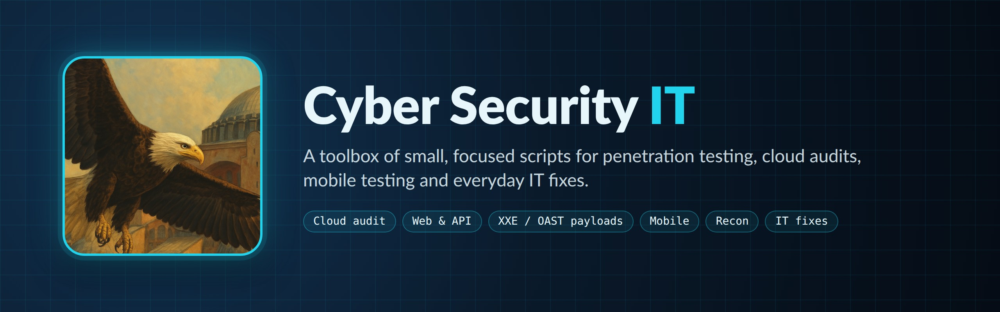

<p align="center">
  
</p>

<p align="center">
  Small, focused scripts collected from real penetration tests, cloud audits, mobile assessments and day-to-day IT work.
  <br>Each script is standalone: pick the one you need and run it.
</p>

<p align="center">
  
  
  
  
  
</p>

---

## Contents

| | Category | Scripts |
|---|---|---|
| ☁️ | [Cloud](#cloud) | AWS security audit (EN / FR) |
| 🌐 | [Web & API](#web--api) | OIDC config audit, Spring Actuator scanner, page recon console, SAP RECON PoC |
| 📄 | [File-based payloads](#file-based-payloads) | XXE DOCX / XLSX / PDF builders, sized file generator |
| 📱 | [Mobile](#mobile) | Android framework detection, iOS app inventory, Wi-Fi watcher service |
| 🔎 | [Recon & reporting](#recon--reporting) | Live host checker, scope compare, Nuclei report viewer, key inspector |
| 🛠️ | [IT & utilities](#it--utilities) | GlobalProtect reset, BCM4322 Wi-Fi fix, H5P video seek, image caption overlay |

```
.
├── cloud/       AWS security audit
├── web/         Web, API and identity checks
├── payloads/    Malicious-document and upload test files
├── mobile/      Android and iOS helpers
├── recon/       Discovery and reporting
└── it/          Everyday IT fixes and small tools
```

`EN` / `FR` / `TR` shows the language of each script's output. Several scripts let you choose the
language at runtime.

---

## Cloud

| Script | What it does | Lang |
|---|---|---|
| [`aws_security_audit_en.py`](cloud/aws_security_audit_en.py) | Read-only AWS security review through the AWS CLI. Covers IAM (users, roles, policies, MFA), S3 (public access, encryption, policy status), CloudTrail, GuardDuty, Security Hub, RDS, EC2 / security groups, CloudFront, Route 53, DynamoDB, Elasticsearch and ELB. Each command is printed with a short explanation. | EN |
| [`aws_security_audit_fr.py`](cloud/aws_security_audit_fr.py) | French version covering IAM, S3, CloudTrail, GuardDuty, Security Hub, RDS and EC2. | FR |

```bash
python3 cloud/aws_security_audit_en.py
```
> Needs a configured AWS CLI (`aws configure`) and `boto3`. The S3 checks use the placeholder
> bucket `example-bucket`; replace it with the bucket you are reviewing.

## Web & API

| Script | What it does | Lang |
|---|---|---|
| [`oidc_config_audit.py`](web/oidc_config_audit.py) | Fetches an OpenID Connect discovery document (`/.well-known/openid-configuration`) and flags risky settings: implicit-flow response types (`token`, `id_token`), missing `RS256`, missing `openid` scope, PKCE methods, weak client authentication methods and the `implicit` grant. Each alert comes with the reason and a recommendation. | FR |
| [`spring_actuator_scanner.py`](web/spring_actuator_scanner.py) | Probes 16 Spring Boot Actuator endpoints (`/env`, `/heapdump`, `/mappings`, `/loggers`, …) and reports for each one whether it is exposed (200), forbidden (403) or absent (404). | FR |
| [`page_recon_console.js`](web/page_recon_console.js) | Paste into the browser DevTools console. It opens a report tab with element counts, URLs and endpoints found in the DOM, HTML comments, front-end libraries (jQuery, Bootstrap, React, Next.js, Vue, Angular) and exposed secrets (Stripe, Slack, AWS, Google, GitHub, GitLab, SendGrid, Mailgun, …). | EN / FR |
| [`sap_recon_cve_2020_6287_admin.py`](web/sap_recon_cve_2020_6287_admin.py) | Proof of concept for **CVE-2020-6287 (RECON)** in SAP NetWeaver AS Java: attempts to create a user through the unauthenticated LM Configuration Wizard endpoint (`/CTCWebService/CTCWebServiceBean/ConfigServlet`). | EN |
| [`sap_recon_cve_2020_6287_user.py`](web/sap_recon_cve_2020_6287_user.py) | Variant of the same proof of concept. | EN |

```bash
python3 web/oidc_config_audit.py                     # prompts for the discovery URL
python3 web/spring_actuator_scanner.py https://target.example
python3 web/sap_recon_cve_2020_6287_user.py          # prompts for target, username, password
```

## File-based payloads

Payload generators for testing upload and document-processing features with out-of-band (OAST)
callbacks, e.g. Burp Collaborator or interactsh.

| Script | What it does | Lang |
|---|---|---|
| [`xxe_docx_builder.py`](payloads/xxe_docx_builder.py) | Builds a `.docx` with XXE payloads in three modes: standard OAST callback, local file read plus OAST (default `/etc/passwd`), or SSRF plus OAST (default AWS metadata). | EN |
| [`xxe_xlsx_builder.py`](payloads/xxe_xlsx_builder.py) | Builds an `.xlsx` with an XXE entity pointing to your OOB URL, then verifies which internal XML parts carry the payload. | EN / FR |
| [`xxe_pdf_builder.py`](payloads/xxe_pdf_builder.py) | Builds a PDF that triggers callbacks to your domain through XMP metadata, JavaScript and embedded files. Modes: `minimal`, `xmp-only`, `js-only`, `full`. Every file gets a random ID, so callbacks can be traced back to it; the SHA-256 is logged to `logs/`. | EN |
| [`sized_file_generator.py`](payloads/sized_file_generator.py) | Generates a PDF (fake text) or PNG/JPG (random pixels) of an exact target size in MB, for testing upload size limits. | EN / FR |

```bash
python3 payloads/xxe_docx_builder.py                 # interactive
python3 payloads/xxe_xlsx_builder.py report.xlsx http://YOUR-OAST-DOMAIN --lang en
python3 payloads/xxe_pdf_builder.py invoice.pdf https://YOUR-OAST-DOMAIN --mode full
python3 payloads/sized_file_generator.py             # interactive
```

## Mobile

| Script | What it does | Lang |
|---|---|---|
| [`android_framework_detect.js`](mobile/android_framework_detect.js) | Frida script that identifies which framework an Android app is built with (Flutter, React Native, Xamarin, Unity, Cordova/Ionic, NativeScript, Qt, …) from its loaded classes, and looks for `libflutter.so`. | FR |
| [`ios_app_inventory_en.py`](mobile/ios_app_inventory_en.py) | Connects to a jailbroken iOS device over SSH and lists the installed apps with their bundle ID, binary path and data-container path. | EN |
| [`ios_app_inventory_fr.py`](mobile/ios_app_inventory_fr.py) | French version of the same script. | FR |
| [`WifiWatcherService.kt`](mobile/WifiWatcherService.kt) | Android foreground service (Kotlin) that posts a notification when Wi-Fi connects, disconnects or changes SSID. Drop it into an Android project. | EN |

```bash
frida -U -f com.example.app -l mobile/android_framework_detect.js
python3 mobile/ios_app_inventory_en.py               # prompts for device IP and SSH credentials
```
> `WifiWatcherService.kt` must be registered as a service in your app's manifest, together with the
> Wi-Fi state, location (needed to read the SSID) and foreground-service permissions.

## Recon & reporting

| Script | What it does | Lang |
|---|---|---|
| [`live_host_checker.sh`](recon/live_host_checker.sh) | For every host in `hosts.txt`: resolves the IP, pings it, tests HTTP/HTTPS and checks 21 common ports. Ends with a live/down summary. | EN |
| [`scope_compare.py`](recon/scope_compare.py) | Compares two scope or domain lists. It normalises the domains, writes common and unique entries to separate files, then checks which ones are live. | EN / FR |
| [`nuclei_report_viewer.py`](recon/nuclei_report_viewer.py) | Turns Nuclei JSON output into a coloured table with a severity summary. Filter by severity, sort, limit the output and export to CSV. | EN / FR |
| [`key_inspector.sh`](recon/key_inspector.sh) | Identifies a key (RSA/ECC, public/private, PEM/PKCS#8/OpenSSH), prints its length and SHA-256 fingerprint, and saves a small JSON report. | EN |

```bash
bash recon/live_host_checker.sh                      # reads hosts.txt in the current directory
python3 recon/scope_compare.py                       # prompts for language and both files
python3 recon/nuclei_report_viewer.py results.json --severity high --sort severity --export csv
bash recon/key_inspector.sh key.txt
```

## IT & utilities

| Script | What it does | Lang |
|---|---|---|
| [`Reset-GlobalProtectSession.ps1`](it/Reset-GlobalProtectSession.ps1) | Fixes a stuck Palo Alto GlobalProtect client: stops the service, clears its cached configuration and starts it again. | EN |
| [`bcm4322_wifi_fix.sh`](it/bcm4322_wifi_fix.sh) | Gets Broadcom BCM4322 Wi-Fi working on Linux (e.g. older MacBooks): installs the b43 firmware and blacklists the conflicting `wl` driver. | EN / FR |
| [`h5p_video_seek.js`](it/h5p_video_seek.js) | Browser console snippet that jumps an H5P interactive video, including embedded YouTube, to a given minute. | EN |
| [`image_caption_overlay.py`](it/image_caption_overlay.py) | Batch-resizes images and stamps a large caption on a semi-transparent bar while keeping EXIF data. Output is written to `output_<name>`. | TR |

```powershell
powershell -ExecutionPolicy Bypass -File .\it\Reset-GlobalProtectSession.ps1   # run as administrator
```
```bash
sudo bash it/bcm4322_wifi_fix.sh
python3 it/image_caption_overlay.py -i "photos/*.jpg" -t "SAMPLE" --scale 1.5 --font-percent 0.35
```

---

## Requirements

Install only what the script you need uses:

| Package / tool | Used by |
|---|---|
| `requests` | oidc_config_audit, spring_actuator_scanner, sap_recon_cve_2020_6287_*, scope_compare |
| `colorama` | oidc_config_audit, nuclei_report_viewer |
| `tabulate` | nuclei_report_viewer |
| `boto3` + AWS CLI | aws_security_audit_* |
| `paramiko` | ios_app_inventory_* |
| `PyPDF2` | xxe_pdf_builder |
| `fpdf`, `faker`, `Pillow`, `numpy` | sized_file_generator |
| `Pillow` | image_caption_overlay |
| `frida-tools` | android_framework_detect.js |
| `dig`/`host`, `curl`, `nc`, `openssl` | live_host_checker.sh, key_inspector.sh |

```bash
pip install requests colorama tabulate boto3 paramiko PyPDF2 fpdf faker Pillow numpy frida-tools
```

## Disclaimer

These tools are intended for authorised security testing, auditing and education only. Run them
only against systems you own or have explicit written permission to test. You are responsible for
how you use them.
